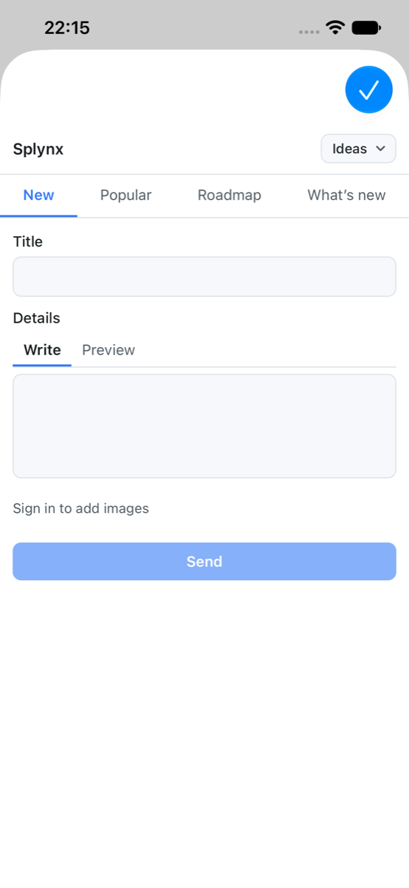
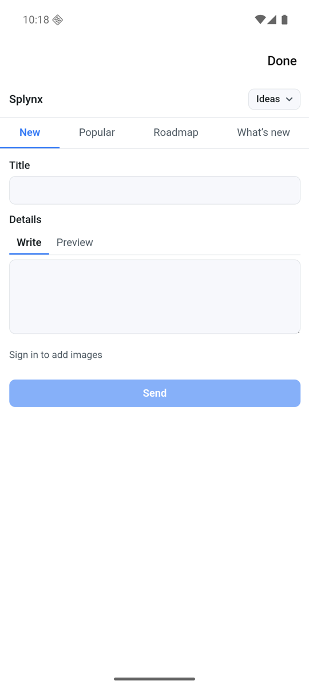

# AntNexo for React Native

Put your [AntNexo](https://antnexo.com) feedback board, roadmap and What's new inside your React Native app. People
post ideas and bugs, vote, follow the roadmap and read your release notes without leaving the app. Every post carries
the app's version, OS version and device model, so you know where it came from.

<p>
  
  
</p>

- iOS 15.1+ and Android 7.0+ (API 24); React Native 0.81+ with the new architecture; Expo SDK 54+ through a
  development build (not Expo Go)
- The person can post as a guest (where your workspace allows it), sign in with an email code, Google or GitHub, or be
  signed in by your app (identify)
- 25 languages; light and dark follow the system
- MIT licence

It is a thin native module over AntNexo's [Swift](https://github.com/AntNexo/antnexo-swift) and
[Android](https://github.com/AntNexo/antnexo-android) SDKs: the sheet, sign-in, screenshots and the security rules
are theirs, compiled into this package. No other native dependency.

## Install

From the GitHub release for now (npm follows); the release asset is the built package:

```sh
npm install https://github.com/AntNexo/antnexo-react-native/releases/download/v1.0.0/antnexo-react-native-1.0.0.tgz
cd ios && pod install
```

**Expo:** add the package, then `npx expo prebuild` and `npx expo run:ios` / `run:android` (a development build: Expo
Go can't load native modules, and calls there reject with `unavailable`). No config plugin is needed.

Don't add `antnexo-swift` or `antnexo-android` to the same app: this package already contains them, and Android would
see the classes twice.

## Show the sheet

Configure once at startup with your workspace's board host. Use `https://<slug>.antnexo.com`: it works on every plan
and keeps working if you add or change a custom domain.

```tsx
import { AntNexo, AntNexoSheet } from '@antnexo/react-native';

await AntNexo.configure({ host: 'https://acme.antnexo.com', workspace: 'acme' });
```

**As a call**

```tsx
await AntNexo.show();                       // resolves when the sheet is closed again
await AntNexo.show({ tab: 'roadmap' });
AntNexo.close();                            // closes it from code, as Done does
```

**As a component** (it renders nothing itself; the sheet is native)

```tsx
const [feedback, setFeedback] = useState(false);

<Button title="Send feedback" onPress={() => setFeedback(true)} />
<AntNexoSheet visible={feedback} onDismiss={() => setFeedback(false)} />
```

One sheet at a time: while one is up or opening, `show()` resolves at once. Tabs: `new`, `popular`, `roadmap`,
`changelog`. More options at `configure`:

```tsx
await AntNexo.configure({
  host: 'https://acme.antnexo.com',
  workspace: 'acme',
  tabs: ['new', 'roadmap', 'changelog'], // which tabs, in that order
  boards: ['ideas', 'bugs'],             // which boards
  theme: 'auto',                         // 'light', 'dark' or 'auto' (the default)
  color: '#4f46e5',                      // accent
  prompts: true,                         // your team's in-app questions
  whatsNew: 'badge',                     // 'badge', 'popup' or 'off'
  // language: 'de',                     // by default the app's language
});
```

## Sign the person in from your app (identify)

If your app has its own accounts, sign the person in to the board as themselves: your **backend** signs a short-lived
HS256 JWT with the workspace's identify secret (admin → workspace settings → Widget → Identify secret) — `sub`,
`email`, `exp` (≤ 24 h), optionally `name`, `company`, `mrr` — and the app fetches it when the sheet opens:

```tsx
AntNexo.identify(async () => (await myApi.antnexoToken()) ?? null); // null opens signed out
```

The provider is called each time the sheet opens; if it fails, returns nothing or takes longer than 10 seconds, the
sheet opens anyway and the person can sign in our way. **Never put the identify secret in the app.** The token goes to
the page through the native bridge for that one opening, never in a URL or a log.

On every account switch (sign out, another user):

```tsx
AntNexo.identify(null);     // or a provider for the new account
await AntNexo.logout();     // clears the sheet's session, closes an open sheet, cancels an opening in progress
```

## What's new badge

```tsx
const count = await AntNexo.unreadCount(); // entries the person hasn't seen yet
```

The count stays in step with the sheet: when the person opens What's new there, an `unread` event reports 0.

## Screenshot

```tsx
await AntNexo.show({ screenshot: true });
<AntNexoSheet visible={feedback} onDismiss={() => setFeedback(false)} screenshot />
```

Takes a screenshot of the app as it is (before the sheet opens) and offers it as an attachment on the new post. The
person sees it and can remove it; it is uploaded only when they send, only when they are signed in and your workspace
has attachments on. Off by default: the screen can hold private data.

## Events

```tsx
const sub = AntNexo.addListener((e) => {
  switch (e.type) {
    case 'posted': console.log('new post', e.id); break;
    case 'unread': setBadge(e.count); break;
    case 'signed_in': console.log('signed in:', e.signedIn); break;
    case 'identify_failed': console.warn('identify refused:', e.code); break; // e.g. an expired token
    case 'closed': break;
  }
});
sub.remove();
```

## Errors

Calls reject with `AntNexoError` and a `code`:

| code | when |
|---|---|
| `invalid_host`, `invalid_workspace`, `invalid_options` | `configure` / `show` got a bad value |
| `not_configured` | `show` before `configure` |
| `network`, `http` (with `status`), `bad_response` | `unreadCount` couldn't read the changelog |
| `unavailable` | the native module isn't in this build (web, Expo Go, `pod install` or a rebuild missing) |

## Privacy

Nothing personal is sent before the sheet opens: the only earlier request is the public changelog, when you call
`unreadCount()` for a badge. With a post the SDK sends the app's name, version and build, the OS and its version, the
device model, the locale and the SDK version — no device identifiers, no advertising ID, no tracking. Your workspace
shows them on the post in the admin; erasing a person removes them.

## How it works (design notes)

- The sheet is AntNexo's widget in app mode (`<host>/app`) in a native WebView with a small bridge, presented by the
  Swift and Android SDKs. Features and fixes to the widget reach your app without an update.
- Why not `react-native-webview`: on Android it can't inject the bridge only into your board's main frame before the
  page runs, or take messages only from it, and the SDKs' security rules need both.
- The SDKs' sources are vendored at tagged releases by `scripts/vendor.sh` (`vendor.json` records the tags and commits;
  CI checks the copy). In the pod the two Swift modules become one; on Android the library's namespace is
  `com.antnexo`, like the SDK's.
- The identify token is fetched in JavaScript and handed to native code for one opening only; it is dropped when that
  sheet closes.
- Posts say `platform: react-native` and this package's version.
- A JavaScript reload (Fast Refresh) while the sheet is open leaves the sheet up; it closes normally with Done, and
  the reloaded JavaScript starts with no sheet of its own.
- Everything else — links in the system browser, Google/GitHub sign-in in the system's sign-in sheet, the WebView
  loading only your board's page, logout scope — is described in the
  [Swift](https://github.com/AntNexo/antnexo-swift#how-it-works-design-notes) and
  [Android](https://github.com/AntNexo/antnexo-android#how-it-works-design-notes) READMEs.

## Example app

`example/` is a bare React Native app using the package from source: `yarn`, then `yarn example ios` or
`yarn example android`. For scripted checks it takes launch options — iOS launch arguments
(`-host … -workspace … -identify <token> -scenario show|roadmap|screenshot|sheet`, plus `-probe 1 -js1 "<code>"` in
debug builds to run JS in the sheet and log to the app's Documents/probe.log), Android intent extras (`--es scenario
show`; the debug build allows WebView debugging over Chrome DevTools).

## Licence

MIT
